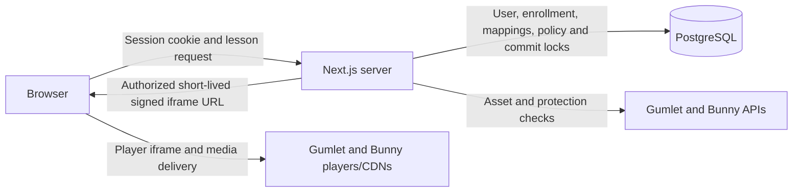

# Secure VDO Streaming

A small **Next.js + TypeScript** prototype for educators and developers who need to evaluate secure video delivery for a **vdo platform**. Compare the **same authorized course video on Gumlet and Bunny Stream**, with login, enrollment checks, short-lived playback links, and browser observations.

**Getting started?** Follow [First run](#first-run), [Connect both providers](#connect-both-providers), and [Testing and verification](#testing-and-verification). Expand the sections below for configuration, troubleshooting, and deployment help.

[Scope and status](#scope-and-status) · [First run](#first-run) · [Providers](#connect-both-providers) · [Configuration](#configuration-reference) · [Tests](#testing-and-verification) · [Security](#how-it-works-and-security-limits) · [Code map](#code-map) · [Operations](#deployment-data-and-ownership) · [Troubleshooting / FAQ](#troubleshooting-and-faq)

> **The prototype is implemented; real provider playback is not yet verified.** You must supply private provider access and authorized video assets. This repository does not include credentials, video files, existing users, or a deployment.

## Scope and status

| Question | Answer |
| --- | --- |
| What is included? | Signup/login/logout, inline test enrollment, both real provider integrations, signed playback, access/expiry probes, saved observations, and essential admin setup. |
| What is deliberately excluded? | A new LMS, course authoring/search/marketing, learning-progress tracking, browser uploads, URL imports, catalog browsing, and integration with existing vdo platform accounts or paid entitlements. |
| Are the videos mocked? | **No.** Runtime calls actual provider APIs. Fixtures exist only in tests; no fallback stream is substituted. |
| What has passed? | Last application verification, **24 November 2026**: **81 offline tests + 19 production browser/API tests**, types, lint, build, and dependency audit. See [the dated evidence](docs/verification.md) and [CI runs](https://github.com/AmnaKhan1323/secure-vdo-streaming/actions). |
| What is still unverified? | Real media playback on both providers, provider rejection of expired/tampered tokens, wrong-domain/unsigned-media enforcement, and native PostgreSQL production deployment. **Four live checks were skipped**, not passed. |
| Is it production-ready? | Not certified. Complete provider/browser acceptance, real entitlement integration, and the [production checklist](#deployment-data-and-ownership) first. |

**Accounts:** signup creates a student, never an admin. An admin can configure providers/link videos and run negative-token tests; **both students and admins must enroll before playback**. Provider keys are server configuration, not browser form inputs.

## First run

1. Clone/download [this repository](https://github.com/AmnaKhan1323/secure-vdo-streaming) and open its root folder.
2. Install **Node.js 22.12+** with npm; **Node 24** is the tested/recommended version.
3. Use the local mode below if you do not already have PostgreSQL. **No Docker or provider account is needed to explore login and the blocked setup states.**

```powershell
npm.cmd ci
npm.cmd run db:generate
npm.cmd run dev:local
```

On macOS/Linux, use `npm` instead of `npm.cmd` throughout this guide. `npm ci` uses the committed lockfile; use `npm install` when intentionally changing dependencies.

Open **[localhost:3000/signup](http://localhost:3000/signup)**. Sign up with your own email/name and a **12–128 character password**. There is no shared/default account. The two provider slots showing **Credentials required** without a video is the correct initial state.

<details>
<summary><strong>What local mode creates, ports, and how to stop/restart</strong></summary>

- The launcher runs PostgreSQL compiled to WASM (**PGlite**) on `127.0.0.1:5433`, applies migrations, and starts the app on port **3000**, bound to loopback. PGlite is a local database, not a mock provider.
- Data and a generated private session secret persist in the ignored **.local** folder. Stop with **Ctrl+C**; run the same command to restart. Do not delete this folder if you want to keep accounts, sessions, enrollment, and mappings.
- On an empty course database, it adds **Playback test course / Authorized test video** and an intentionally closed **Enrollment-denial test course**. They contain text only, not real curricula or media.
- Existing databases are not expanded on every restart. The explicit `db:seed` command inserts missing seed records without overwriting existing ones; it is **not** a data reset.
- For `dev:local`, `DATABASE_URL` must be unset/empty in the shell and configuration. Normally leave `BETTER_AUTH_SECRET` and `POSTGRES_PASSWORD` empty too; the launcher manages its private secret.
- Use one exact origin consistently: `localhost` and `127.0.0.1` are different for cookies/origin checks. If set, `BETTER_AUTH_URL` must match the chosen loopback origin/port.
- Optional `PORT` and `STREAMLAB_DB_PORT` change local ports. Update the auth origin and provider hostnames accordingly; the admin CLI needs the same database port. Two local DB connections support the app plus an admin command.
- Do not run `dev` and `build` together: they share **.next**. Stop dev/preview before a new build. For an already-built local preview use `npm.cmd run dev:local -- --production` after building.

</details>

### Enable admin access

Keep the local app running. In a **second terminal in the same project**, replace the email with the one you signed up with:

```powershell
npm.cmd run admin:promote -- --local --email your-email@example.com
```

Refresh the browser to see **Provider setup**. The command promotes an **existing account only**; it never creates an account/password. For native PostgreSQL, omit `--local` and supply `DATABASE_URL`. This is a trusted server/operator command, not a public role-upgrade endpoint.

## Connect both providers

Use a dedicated test workspace/library: provider policy changes can affect other videos in the same scope. You need permission to upload/use the media; a public course/YouTube link is **not** a provider asset ID or a grant to rehost it.

1. Create **.env.local** in your editor from [the environment template](.env.example). Add both providers' values from the [configuration reference](#configuration-reference). Keep local-mode database/auth-secret fields empty and use `BETTER_AUTH_URL=http://localhost:3000`.
2. **Restart the app** after changing server environment values. **Keys present** means values exist, not that they are correct or playback has passed.
3. Upload the **same authorized file** into Gumlet and Bunny, or use existing authorized assets of the same video. Wait for processing. The app does not upload, import, or transcode videos.
4. Configure signing, allowed hostnames, media/CDN protection, and download controls in the vendor consoles; see the expandable provider checklist below.
5. In admin **Provider setup**, enter the actual allowed hostnames, a token TTL, and enable **Allow authorized playback** for each provider. **Save settings**, then **Check live configuration**. Do not enter a key in a hostname/video-ID field.
6. Under **Link test videos**, choose the **same Test lesson** for both mappings. Select Gumlet, enter its real asset ID, and click **Verify & link video**. Repeat for Bunny using its video GUID. Replacing a mapping requires confirmation.
7. Return to **Video comparison → Course access**, choose the open playback test course, and **Enroll for testing**—even if you are admin. Select its lesson, click **Run both providers**, then press play inside each iframe if needed.
8. Read the side-by-side observations. Refresh after a run and expand **Saved test runs** for your latest 30 stored attempts. Each provider creates its own attempt; unavailable measurements stay empty, not zero.

**Paired-run prerequisites:** enrolled lesson + both video mappings + both providers configured, enabled, and not updating/failed. Remote protection/readiness is checked again on every issuance. **Test this provider** supports an individual run when that provider is ready; the paired comparison still requires both.

<details>
<summary><strong>Provider checklist, Save versus Check, and failed-update recovery</strong></summary>

| Provider | Required checks before accepting playback |
| --- | --- |
| Gumlet | A ready adaptive asset in the configured workspace, effective asset signing enabled, explicit MP4 access disabled, workspace signed URLs/referrer restrictions, matching verifiable key, and download button disabled manually. Unknown signing/output/protection state blocks playback. |
| Bunny | A ready video in the configured Stream library, embed-token authentication **and** linked Pull Zone CDN tokens, enforced referrers including blocked missing referrers, no MP4/original/direct/early-play exposure or token-bypass edge rules, matching verifiable token key, and the correct player version/host. The current adapter compares `BUNNY_TOKEN_AUTH_KEY` with the linked Pull Zone's returned `ZoneSecurityKey`; missing/different values block playback. Confirm account compatibility rather than assuming these keys are interchangeable. |

- Hostnames have **no scheme, path, or port**, e.g. `localhost` or `courses.example.com`. Apex and `www` are different. Local policy does not automatically configure the provider. Remote lists broader than your approved local policy are rejected.
- **Save settings** normally saves the app's local policy only. **Check live configuration** reads a remote report; it does not play media or persist a certification.
- The **Also apply...** checkbox authorizes documented **real provider mutations**. Gumlet replaces the remote referrer list; Bunny adds domains without removing existing extras. Review shared-scope impact first. No keys are rotated by the app. Some settings, including the Gumlet download button, need manual console work.
- During a save the provider is disabled for new app issuance. Partial failure stays **failed/disabled** and changes its revision. Inspect the provider console and fix the cause, then use **Reload saved settings** or refresh; review/re-enter the intended policy, re-enable playback, and Save. Enabling recovery requires a fresh remote verification. An abandoned operation can be taken over after **10 minutes**.
- A newer mapping or policy revision invalidates stale in-flight authorization. Vendor-console edits and already-started remote API calls are not transactional with this database; inspect partial changes rather than assuming rollback.

Exact account-specific fields, encoding notes, API endpoints, and official links are in [the provider reference](docs/setup.md#gumlet-protection-and-apis) and [Bunny section](docs/setup.md#bunny-protection-and-apis). Do not weaken a protection check just to make a video play.

</details>

## Configuration reference

**All keys/secrets are server-only. Never put them in `NEXT_PUBLIC_*`, Git, chat, shared logs, screenshots, or complete playback URLs.** [The template](.env.example) lists names, not working accounts. Restart after changes.

<details>
<summary><strong>Every template variable: what it means and when it is needed</strong></summary>

| Variable | Purpose / requirement |
| --- | --- |
| `DATABASE_URL` | Native/managed PostgreSQL connection. **Empty for `dev:local`**; explicitly supply the intended target for native runtime, migrations, and seeding. Generation/build do not require a live DB. See the migration-fallback warning below. |
| `POSTGRES_PASSWORD` | Required by the optional Compose database, not by PGlite. If using Compose, the password in `DATABASE_URL` must match; URL-encode special characters. |
| `BETTER_AUTH_SECRET` | Cryptographically random server secret, at least 32 characters. Local launcher generates/reuses its own when this is empty. Supply a stable private value for native/production use. |
| `BETTER_AUTH_URL` | Exact application origin: scheme + hostname + optional port only. Local example: `http://localhost:3000`; production requires HTTPS. No path/query/fragment. |
| `GUMLET_API_KEY` | Gumlet management API access to the intended Video workspace/assets. |
| `GUMLET_WORKSPACE_ID` | Workspace containing the linked Gumlet asset; not a video ID. |
| `GUMLET_SIGNING_SECRET` | Current iframe signing key for that workspace. Not the API key. |
| `GUMLET_SIGNING_SECRET_ENCODING` | Local key representation: `base64` by default, or provider-confirmed `hex`. Never guessed. |
| `GUMLET_REMOTE_SECRET_ENCODING` | API-returned key representation for comparison; when unset, inherits the local encoding. Confirm both representations with the provider. |
| `BUNNY_STREAM_API_KEY` | Per-library Stream content API key. |
| `BUNNY_LIBRARY_ID` | Numeric Stream library ID containing the linked video. |
| `BUNNY_TOKEN_AUTH_KEY` | Library embed-token authentication key, distinct from API credentials. |
| `BUNNY_CORE_API_KEY` | Separate Core API credential permitted to inspect/manage the library and linked Pull Zone. Do not assume the Stream key grants this access. |
| `BUNNY_PLAYER_HOST` | Default `player.mediadelivery.net`, requiring PlayerVersion 2. Explicit legacy `iframe.mediadelivery.net` requires version 1; provider documentation schedules legacy removal in early 2027, so reconfirm before using it. |
| `LIVE_GUMLET_ASSET_ID` | Real processed asset ID for live API checks only. Also link that asset in the app if you want to test it in the UI. |
| `LIVE_BUNNY_VIDEO_ID` | Real processed Bunny video GUID for live checks only; it does not create a lesson mapping automatically. |
| `LIVE_EMBED_PROBES` | Optional `true` enables signed-iframe HTTP-shell probes. Requires credentials/live IDs and a provider-allowed `BETTER_AUTH_URL`. HTTP 200 is **not** playback evidence. |

**File-loading rule:** local launcher/admin/live scripts support **.env.local**. Prisma migrations and the standalone seed load **.env** or process environment, **not automatically .env.local**. For native PostgreSQL/Compose, use **.env** from the same template, or inject real process environment values. Avoid conflicting copies across files; shell variables take precedence, and standalone scripts do not all use Next.js's file-precedence rules.

**Migration safety:** [prisma.config.ts](prisma.config.ts) has a localhost fallback when `DATABASE_URL` is unset, so generation can work without a configured database. A migration could therefore attempt that local database instead of failing for a missing variable. **Explicitly set and verify the intended database before migrating**; do not rely on an unset variable to stop it. Runtime and the standalone seed require the connection value.

**What is stored where?** Credentials, database connection, and auth origin/secret are environment configuration. Users, sessions, enrollments, lesson-to-video mappings, enabled state, TTL, domains, revisions, and observations are database state. Encoded videos and actual vendor security settings belong to provider accounts. Copying an environment file does not copy the other two.

</details>

## Testing and verification

Stop the dev/preview server before the build checks. Use a disposable/authorized provider scope for live acceptance, not someone else's active library.

```powershell
npm.cmd run check
npm.cmd run test:e2e
npm.cmd run test:live
npm.cmd audit --audit-level=high
```

`check` runs types, lint, offline tests, and a production build. E2E needs that build: its own server uses **port 3001** and an isolated in-memory database on **15438**, not your local data. Windows defaults to installed **Microsoft Edge**; otherwise install Playwright Chromium with `npx playwright install chromium` and set `PLAYWRIGHT_CHANNEL=chromium` on Windows. Linux CI uses `npx playwright install --with-deps chromium`.

<details>
<summary><strong>What the results prove, measurement meanings, and browser acceptance</strong></summary>

| Check | What a pass establishes | What it does not establish |
| --- | --- | --- |
| Offline tests | Signature vectors, API contracts, authorization, policy failures, SDK lifecycle, database/migration behavior. | Real account/provider playback. Fixtures are test-only. |
| Production browser/API tests | Built app with real Better Auth + Prisma and isolated data: enrollment, denials, admin tools, UI, and lifecycle boundaries. Provider credentials are explicitly blanked. | Video decoding or actual provider rejection. |
| Live API tests | Read-only checks of real assets/protection plus generated signature structure. Missing credentials/assets cause explicit skips. | Successful playback or full CDN/domain enforcement. The optional HTTP tests only reach the iframe shell. |
| Credentialed browser acceptance | Actual playback and provider/media denial evidence under the tested settings. | A blanket production/security guarantee across accounts, networks, or future settings. |

Use **Test without a session** and **Test without enrollment**: both provider request paths must return the expected 401/403 code without a playback URL. The enrollment button needs at least one published, non-enrolled lesson; the closed fixture is deliberately suitable for denial tests.

Admins can select normal, **60-second**, already-expired, or tampered tokens. Standard policy defaults to **300 seconds**, configurable **60–3,600**. A student's request cannot override TTL or request negative tokens.

- **Token API round trip** includes app authorization, provider checks, network time, signing, and commit. **API server** issuance time excludes the final persistence step.
- **Iframe loaded** is not **Player ready**, and neither is **Playback observed**. The latter requires advancing valid media time while playing, not a decoded-first-frame benchmark; user click delay affects it.
- Two parallel players compete for bandwidth. Compare repeated, foreground-tab trials of the same encoding/content/network, including individual runs. No provider is declared faster without real data.
- A 25-second readiness timeout is **inconclusive**. App expiry removes the normal iframe and offers renewal; it does not prove that the provider rejected an expired token. Negative probes keep the iframe mounted to observe actual behavior.
- Observations are client-reported diagnostics, not tamper-proof analytics. A save error means displayed values may be browser-local; refresh Saved test runs to confirm persistence.

For **each provider**, record real advancing playback, expired/tampered denial, wrong/missing-referrer rejection, and unsigned **manifest and segment** denial. Do not share full bearer URLs. Follow [the evidence checklist](docs/testing.md#browser-playback-evidence), including buffered-media and renewal caveats.

</details>

## How it works and security limits



The app authorizes playback and records observations; it **does not proxy/store video files**. Video encoding/storage/delivery remain with the providers and may incur costs.

<details>
<summary><strong>Protection boundaries, signing details, and what cannot be promised</strong></summary>

- Better Auth handles passwords and database sessions; cookies are HTTP-only/SameSite, secure over HTTPS. Signup cannot grant admin. User/session/role and enrollment are read fresh rather than trusting client-supplied identity.
- Every issuance checks lesson access, actual upstream asset identity/readiness, effective protection, approved local **and** remote hostnames, matching signing keys, and disabled download/media bypasses. Unknown critical state fails closed.
- After provider calls, authorization is rechecked and the commit locks session, enrollment, mapping revision, and policy. Changed/revoked access prevents a new ticket. Admins have no enrollment bypass.
- App mutations require the configured same origin and bounded/validated JSON. Private API responses use no-store; app/auth rate limits remain enabled. Production must replace untrusted forwarded headers and block direct origin access so client IP limits cannot be spoofed.
- **Gumlet iframe:** HMAC-SHA1 hex of the relative embed path and exact serialized query including Unix-second `signed_expires`; explicit key decoding. **Bunny iframe:** SHA-256 hex of token key + video GUID + decimal Unix-second expiry, without separators. These are not direct-media/CDN/DRM signing algorithms.
- Iframe SDK messages are guarded by exact source/origin/context with cleanup on failure. The parent cannot inspect a cross-origin player's HTTP response/DOM, so a timeout is not rejection evidence.
- Signed URLs are **bearer credentials visible to an authorized browser**. They do not hide media requests from that user or provide DRM. No complete prevention of copying/screen recording is claimed.
- Enrollment revocation blocks **new issuance**, not instant revocation of URLs already issued. Buffered playback/cache/provider behavior needs real testing; token expiry is not a guarantee of immediate video stoppage.
- No production email verification/recovery/MFA workflow, payments, real vdo platform entitlement sync, DRM, automatic retention/monitoring, or production-ready nonce CSP is provided. The current CSP permits inline hydration scripts/styles and blocks this app from being framed.

See [setup/security reference](docs/setup.md) and [acceptance guide](docs/testing.md). Never relax protection or remove checks to make an unverified provider state pass.

</details>

## Code map

<details>
<summary><strong>Where to make changes and which routes/data are active</strong></summary>

**Stack:** Next.js App Router, React, TypeScript, Tailwind, Better Auth, PostgreSQL, Prisma 7 + PrismaPg, and the provider Player.js SDKs. Exact locked versions/scripts are in [package.json](package.json) and [package-lock.json](package-lock.json). Keep Prisma 7 until auth-adapter compatibility with a newer major is confirmed.

| Area | Start here |
| --- | --- |
| Shared dashboard/comparison, enrollment, saved runs | [streaming-test-workspace.tsx](src/components/streaming-test-workspace.tsx), [course-access.tsx](src/components/course-access.tsx) |
| Dual-player scenarios, lifecycle, SDK observations | [comparison-lab.tsx](src/components/comparison-lab.tsx), [comparison-player.tsx](src/components/comparison-player.tsx), [trusted-iframe.tsx](src/components/trusted-iframe.tsx), [player-sdk.ts](src/lib/player-sdk.ts) |
| Admin policy and verified video mapping | [admin page](src/app/(workspace)/admin/page.tsx), [admin-provider-card.tsx](src/components/admin-provider-card.tsx), [video-mapping-form.tsx](src/components/video-mapping-form.tsx) |
| Authentication, access and locked playback issuance | [auth.ts](src/lib/server/auth.ts), [authorization.ts](src/lib/server/authorization.ts), [playback-service.ts](src/lib/server/playback-service.ts), [commit-access.ts](src/lib/server/commit-access.ts) |
| Actual vendor API/signature/protection contracts | [provider adapters](src/lib/server/providers), [signing.ts](src/lib/server/providers/signing.ts), [policy.ts](src/lib/server/providers/policy.ts), [provider-configuration.ts](src/lib/server/provider-configuration.ts) |
| Data/schema, insert-only seed and migrations | [schema.prisma](prisma/schema.prisma), [seed.ts](prisma/seed.ts), [test-courses.ts](prisma/test-courses.ts), [migrations](prisma/migrations) |
| Local launch/admin helpers, config and tests | [scripts](scripts), [prisma.config.ts](prisma.config.ts), [next.config.ts](next.config.ts), [tests](tests), [CI workflow](.github/workflows/ci.yml) |
| Neutral product/target wording | [site.ts](src/lib/site.ts). **vdo platform** is display text, never an automatic domain/entitlement grant. |

| Page / API | Purpose |
| --- | --- |
| `/setup`, `/signup`, `/login` | Setup guidance and account access. |
| `/dashboard`, `/comparison` | Same protected comparison workspace; `/admin` adds admin-only setup. |
| `GET/POST /api/auth/[...all]` | Better Auth handlers. |
| `POST /api/enrollments` | Self-enroll in a published, open test course. Closed/unpublished courses remain blocked; no admin bulk-enrollment tool is provided. |
| `POST /api/playback` | Authorize and issue one provider's signed comparison ticket. |
| `POST /api/measurements/[id]` | Save an owned attempt's bounded observations; accepted only within its four-hour measurement window and with current access. |
| `POST /api/admin/videos` | Verify a real asset and link/replace its mapping. |
| `PUT /api/admin/providers/[provider]` | Save policy; optionally apply documented remote changes. `POST .../verify` reads the remote report. Provider identifiers are `GUMLET` / `BUNNY`. |

Custom API errors have `error.code` and `error.message`; use the browser UI or same-origin authenticated requests, not a client-supplied user ID. Request schemas are in [validation.ts](src/lib/validation.ts), and shared ticket/report types are in [types.ts](src/lib/types.ts). Better Auth endpoints use their own response contract.

**Data model:** auth users/sessions/accounts; courses/lessons/enrollments; lesson-video mappings; provider policy/revisions; playback attempts; rate-limit records. Historical `LessonProgress` and old metadata remain to preserve data, but no runtime progress writer/UI exists. Old protected course/lesson URLs redirect to the dashboard. Retired progress/import/catalog APIs return 404. Stable legacy IDs, local helper prefixes, and applied migration names are compatibility identifiers—do not rename them as branding cleanup.

For changes: add tests, make **new additive migrations**, generate the client, run checks, and update the evidence. Never edit an already-applied migration or blindly upgrade provider fields/signatures. The local migration ledger checks normalized SQL checksums; native PostgreSQL acceptance still needs independent verification.

</details>

## Deployment, data, and ownership

<details>
<summary><strong>Native PostgreSQL / production setup</strong></summary>

Use a **Node.js-capable server/container and PostgreSQL**, not static-only hosting. For a fresh native/Compose setup, create **.env** privately from [the template](.env.example) (or inject process environment): set `DATABASE_URL`, a random `BETTER_AUTH_SECRET`, exact `BETTER_AUTH_URL`, and your provider values. Compose additionally needs `POSTGRES_PASSWORD`. Avoid a conflicting local-mode configuration.

```powershell
# Optional: omit this line if PostgreSQL already exists.
docker compose up -d
npm.cmd ci
npm.cmd run db:generate
npm.cmd run db:migrate
npm.cmd run db:seed
npm.cmd run build
npm.cmd start
```

Review/back up an existing database **before** migration; the sequence above is not a reset. Use `npm.cmd run dev` instead of build/start for development against native PostgreSQL. Docker is optional; the example service is [compose.yaml](compose.yaml). Its initialized password is not changed simply by editing the environment file.

For an existing installation, plan a maintenance window: preserve private configuration/data, stop the app before replacing its build, install from the lockfile, generate the client, apply reviewed migrations to the verified database, build, restart, and repeat acceptance checks. Explicit seeding is optional and may add missing test containers; it is not required on every deploy. No automatic deployment or zero-downtime rollback pipeline is included.

Before public use:

- [ ] Approve the actual canonical **HTTPS** origin in auth and both provider policies; no production domain is supplied automatically.
- [ ] Review the production HSTS header: **one year with `includeSubDomains`**. Confirm HTTPS readiness for the chosen hostname and affected subdomains before using it; browsers can cache this policy.
- [ ] Complete real playback, token/domain/CDN acceptance, native PostgreSQL concurrency/backup/restore checks, and capacity testing.
- [ ] Integrate authorized vdo platform login/enrollment/paid entitlements. Open test enrollment is **not** a payment or membership check.
- [ ] Restrict admin/DB/provider access, review signup/email verification/recovery/MFA, trusted proxy headers, rate limits, and CSP. To frame this app inside another site requires a deliberate review of its current frame-deny policy.
- [ ] Define secret rotation, logs/monitoring, retention/privacy, incident response, and provider billing/quota ownership. No load/SLA/production certification is included.

See [detailed deployment guidance](docs/setup.md#standard-postgresql-and-deployment). Uploading this repo to GitHub does **not** deploy it.

</details>

<details>
<summary><strong>Protect your data: backups, access ownership, and license</strong></summary>

- A fresh clone creates fresh local data. Git intentionally excludes private environment files, **.local**, generated client, dependencies, and build/test output. Repo access does not grant old accounts, provider dashboards, database access, or video rights.
- If preserving local data is required, **stop the app/database first**, then back up the entire **.local** folder securely, including its session secret. Transfer/restore only through an approved encrypted/private channel with the app stopped. Protect backups like passwords; do not attach them to public issues or commits.
- For native PostgreSQL, use the host's supported consistent database backup/restore process and test restore in isolation. Transfer secrets separately through a password manager/secret store. Preserve mappings, enrollment, migration history, and intended auth configuration; a new hostname or planned secret rotation can require re-login.
- Do not delete databases, remove migrations, run reset commands, or regenerate the existing secret just to fix a configuration problem. Have a rollback/data-preservation plan before changes.
- Manage GitHub admin access, hosting/DNS, database/backup ownership, provider workspace/library/Pull Zone access, billing, and media authorization separately. Access to this app does not grant access to those accounts.
- Assign responsibility for live verification and production maintenance. Use scoped credentials, rotate/revoke them when account access changes, and reverify playback rather than putting old keys in the repository.
- **Project license is not specified:** no project license file is supplied. Confirm intended use/distribution terms with the repository owner; public visibility and npm's `private: true` flag are not a project license. Third-party dependencies, provider terms, and media rights remain separate responsibilities.

</details>

## Troubleshooting and FAQ

<details>
<summary><strong>Common symptoms and the safest next action</strong></summary>

| Symptom / response | Check / next action |
| --- | --- |
| `DATABASE_URL is already set` in local mode | Choose **one database mode**. Unset the inherited URL for `dev:local`, or use normal dev/start with the configured native database. Do not delete either database. |
| Prisma migrate/seed cannot connect, but Next can | They do not automatically read **.env.local**. Explicitly set the URL in **.env** or process environment and verify the same intended target. Seed requires it; an unset migration URL can fall back to localhost instead of failing. |
| Signup/login or a mutation fails origin validation (403) | Use the exact `BETTER_AUTH_URL` origin, including scheme/port; do not switch localhost/127.0.0.1. Restart after changes and check trusted proxy behavior. |
| Login is rate-limited (429) | Wait before retrying. Better Auth's installed sign-in/signup limit is 3 rapid attempts per 10 seconds; application APIs have separate per-user limits. Do not disable guards to test. |
| Provider setup menu missing / admin 403 | Sign up first, promote that exact account in the **same** database, then refresh. Signup/JSON/browser edits cannot grant admin. |
| No enrolled lesson / `NOT_ENROLLED` (403) | Enroll in the open playback course through Course access, including for admins. The closed denial fixture is intentionally not self-enrollable; no admin enrollment UI is implemented. |
| `Run both providers` disabled | Check enrollment, both mappings, keys, enabled state, and updating/failed state. “Keys present” alone is not verification. |
| `VIDEO_NOT_CONFIGURED` (409) / wrong video ID | Link both IDs to the **same lesson**. Gumlet uses a 24-character hexadecimal asset ID; Bunny uses a UUID video GUID, not a library ID, URL, or API key. |
| `CONFIGURATION_REQUIRED` / `PROVIDER_DISABLED` (503) | Set the missing server values, restart, and save/enable policy. For failed/updating state use the documented recovery workflow. |
| Domain/protection/key/version error | Compare local versus remote allowlists, Gumlet explicit encodings/effective signing, Bunny distinct keys/linked Pull Zone/player version, and MP4/download exposure. Unknown values intentionally fail closed; inspect console/account permissions. |
| `VIDEO_NOT_READY` (409) | Wait for processing and verify a valid duration and adaptive output in the provider console. MP4-only/unknown output cannot pass. |
| Mapping/policy changed or conflict (409) | Refresh/reload saved settings, review the new mapping/revision, and retry intentionally. Do not overwrite another operator's change blindly. |
| Player timeout / blank iframe / SDK setup failure | Keep the tab foreground; check network/content filters, allowed hostnames and SDK errors privately. Use **Retry player setup** or new authorization. Timeout is inconclusive, not proof of rejection. |
| Session expires / observations cannot be saved | Renew to reauthorize; confirm login/enrollment is still valid. Measurements stop after four hours. A displayed value is not proof it reached the DB; refresh saved runs. |
| App manifests break after a build | Stop dev/preview before building; build and dev share output. Restart the appropriate server after a successful build. Do not reset the database. |
| E2E cannot start | Build first, free ports 3001/15438, and ensure the selected Edge/Chromium browser is installed. Offline tests additionally use DB ports 15437/15439/15440; avoid parallel copies of the test suite. |
| Corporate TLS download failure on Node 24 | Use the trusted system CA option `NODE_USE_SYSTEM_CA=1` if applicable. Never disable TLS verification. |

Share only the **sanitized** error code/message, command, Node/browser version, selected provider/scenario, and relevant timestamp when requesting help. Redact environment values, account/session data, full signed URLs, and provider bodies before sharing logs, screenshots, or network traces.

</details>

<details>
<summary><strong>Common questions</strong></summary>

- **Can I paste a course/YouTube URL and play it?** No. Supply authorized media already processed in each provider and link its actual ID. This app has no download/import/upload feature.
- **Where are the videos or default passwords?** They are not in the repo. Create your own account, grant admin explicitly, and obtain provider assets/keys privately.
- **Does adding a `LIVE_*` video ID configure the UI?** No. Live-check IDs and database lesson mappings are separate; set/link both intentionally.
- **Does “saved” or a green API report mean secure playback passed?** No. It confirms a local write/report only; perform browser/media acceptance.
- **Why must an admin enroll?** Playback uses the same enrollment gate for every role. Admin is a management capability, not a paid-course entitlement.
- **Why are old courses/columns/identifier prefixes still present?** To preserve existing data/links. The app no longer provides LMS/progress/import/catalog features. Do not bulk-rename stored IDs.
- **Can I use only one provider?** You can run one ready player individually. The requirement and paired comparison still include **both** Gumlet and Bunny.
- **Which provider is faster, safer, or cheaper?** No live winner/cost estimate is claimed. Measure equivalent assets and review current account pricing, protections, encoding/storage, and bandwidth costs.
- **Can users see the media link or record a video?** An authorized browser receives a temporary bearer URL. Signed URLs are not DRM and cannot guarantee prevention of screen recording.
- **Can I send someone my local URL?** The convenience launcher is loopback-only, so another machine cannot use it. Deploy deliberately with HTTPS/native PostgreSQL and the required protections; do not expose the local DB publicly.
- **Is the app connected to our real vdo platform?** No. Its label does not connect website users, courses, payments, or entitlements; that integration needs authorization and implementation.

</details>

### Setup checklist

- [ ] Install from the lockfile, start the chosen database mode, sign up, and obtain admin access without default credentials.
- [ ] Review the three configuration locations: private environment, application database, and provider consoles.
- [ ] Both provider scopes/keys and authorized assets are owned/accessible by the intended operator; both real IDs are linked to one lesson.
- [ ] Both application access probes and the automated checks pass; skipped live checks are tracked as **pending**, not accepted.
- [ ] Browser evidence is recorded for both providers, including expiry/tampering/domain/unsigned-media tests; limitations are understood.
- [ ] Existing data is either deliberately excluded or securely transferred/restored; backup and secret-rotation responsibilities are assigned.
- [ ] Hosting/DNS, billing, access ownership, project license, and remaining production/integration tasks have named owners.

**Further reference:** [Exact provider/deployment setup](docs/setup.md) · [Browser acceptance and metrics](docs/testing.md) · [Dated verification history](docs/verification.md) · [CI](https://github.com/AmnaKhan1323/secure-vdo-streaming/actions)

For non-sensitive maintenance questions, use [repository issues](https://github.com/AmnaKhan1323/secure-vdo-streaming/issues). Agree a private contact with the owner for access or security matters; never post credentials, user data, or signed URLs publicly.